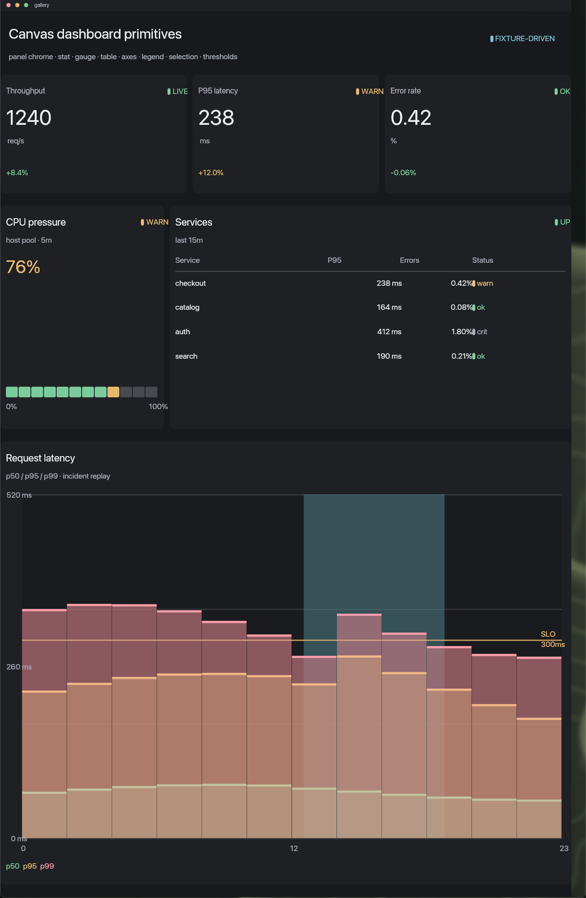

# Shared UI components

Status: **initial library, 2026-11-06.**

`components/fungos.ui.lua` is the first shared component package.

```text
fungos.ui/button
fungos.ui/badge
fungos.ui/avatar
fungos.ui/field
fungos.ui/card
fungos.ui/empty
fungos.ui/list-row
```

Use with `tend`:

```sh
tend build examples/components/demo.lua examples/components/snapshot.lua \
  --component components/fungos.ui.lua \
  --name components-demo \
  --out /tmp/tend-build
```

A component is pure:

```text
(ctx, props, children) -> semantic UiNode
```

No records, network, filesystem, clock or authority. Pass a stable `id` when the
same component appears more than once.

## App usage

```lua
local ui = require("fungos.ui")

return ui.component("fungos.ui/list-row", {
  id = "contact-ada",
  title = "Ada Lovelace",
  subtitle = "CTO · Acme",
  meta = "shared",
  initials = "AL",
})
```

Components resolve immediately before `ui.layout` via the registry installed by
`tend`. Missing components use their fallback and are reported.

## Package shape

The first component package is a Lua module:

```lua
local M = { name = "fungos.ui", version = "0.1.0" }
M.components = { ["fungos.ui/button"] = function(ctx, props) ... end }
return M
```

Later this is a Spore package exporting the same namespaced component identity.
Rust components compile to Wasm and implement the same render contract.

## Dashboard surface primitives



`lua/fungos/dashboard.lua` is the scene-level sibling of the semantic component
package. It is for Canvas views that need panel chrome and metric marks, not for
the host layout tree:

```text
fungos.dashboard/panel    panel chrome + content rect
fungos.dashboard/stat     value, unit, delta, status
fungos.dashboard/gauge    segmented threshold meter
fungos.dashboard/table    rows, columns, zebra, status cells
fungos.dashboard/chart    compact axes, legend, selection, threshold
fungos.dashboard/status   dot + label helper
```

The primitives take `(surface, id, x, y, width, height, opts)` and paint only
`surface:rect` / `surface:text` nodes. They are pure SDK content: Canvas still
owns compositing, focus, placement and input. Status and thresholds resolve to
semantic inks so the active Canvas theme remains in control.

The fixture-driven gallery exercises the whole set through `tend`:

```sh
tend check examples/gallery/view.lua examples/gallery/snapshot.lua
tend examples/gallery/view.lua examples/gallery/snapshot.lua \
  --name gallery --surface gallery
```

Use the semantic `fungos.ui` components for application structure, and
`fungos.dashboard` for a view that needs a retained dashboard scene.
