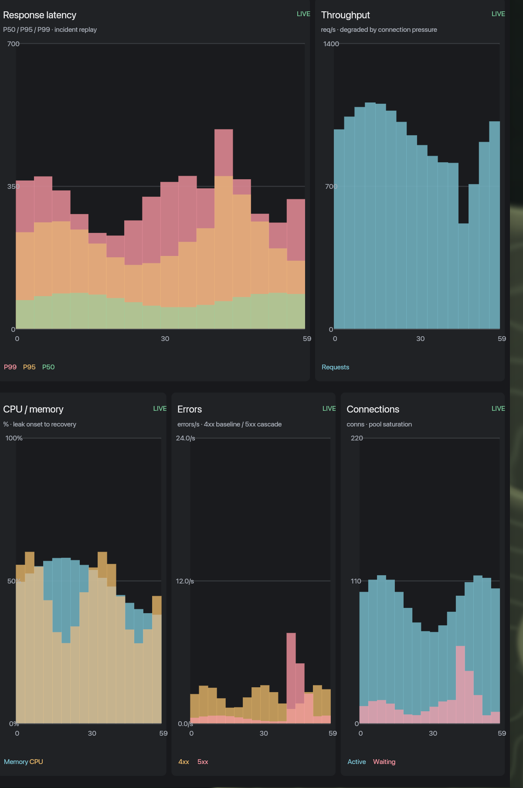

# ChartGPU demo API



## Entrypoint

`compact.lua` exports `M.render(snapshot)` and is the entrypoint used by the
Canvas hot loop. It paints five panels with retained rect nodes and stays well
inside Canvas's 1,024-node / 256 KiB module budget.

`view.lua` is the full `fungos.chart` / `fungos.viz` reference. It is useful for
native or GPU scene hosts, but its polylines expand past the Canvas module
budget and should not be used as the `tend --surface` module without reducing
the sample count.

## Snapshot

`snapshot.lua` returns deterministic `{ x, y }` point arrays for latency,
throughput, resources, errors and connections. The shape mirrors the native
ChartGPU incident replay without requiring the Rust live host.

## Actions

None. This is a presentation-only iteration surface.

## Slots

None.

## Components

Uses `fungos.chart`, `fungos.viz`, and `fungos.ui` sub-surfaces.

## Theme/config

Uses the active `fungos.ui` theme and the ChartGPU dark palette. Canvas's Lua
fallback consumes semantic theme inks; raw RGB is retained in the portable scene
but is not used by the native compositor path.

## Hot loop

```sh
lua tools/tend.lua watch examples/chartgpu/compact.lua \
  examples/chartgpu/snapshot.lua \
  --name chartgpu --surface chartgpu --no-workspace
```

## Dense scene path

`scene_live.lua` is the quality-first Lua path. It does not go through the Lua
module limit: it writes a validated Canvas `scene` surface directly. The producer
reads the current Canvas frame with `canvasctl surfaces` (or
`CANVAS_VIEWPORT=1200x840` for a deterministic capture) and lays out panels,
gutters, text and column density from that viewport. A wider window gets wider
plots instead of a stretched 1200x840 preview.

At 1200x840 the five-panel replay is 597 nodes, with axes, panel chrome and
legends; a 1920x1175 frame grows to 779 nodes. A 1200x840 one-shot patch is about
119 KiB and applies in roughly 0.13 s on the running Canvas.

```sh
lua examples/chartgpu/scene_live.lua --once
# or, for a deliberately low-rate live replay:
lua examples/chartgpu/scene_live.lua --fps 1
```

The scene path gets much closer to the native ChartGPU density than the 16-column
module fallback. It is still a patch per frame: live updates raise Canvas's p95
CPU update time to roughly 28 ms, so it is a quality demo rather than a 60 Hz
replacement. True native smoothness still needs a host line/area primitive or a
GPU lease rather than more Lua scene nodes.

## Stable ids

`compact.lua` namespaces ids by panel prefix (`latency-`, `throughput-`,
`resources-`, `errors-`, `connections-`) and by series/column, so a reload does
not collide with the previous retained scene. `view.lua` uses `fungos.viz` layer
ids and `fungos.chart` surface namespacing.

## Authority

None. Pure presentation; no records, network, clock, filesystem or actions.
