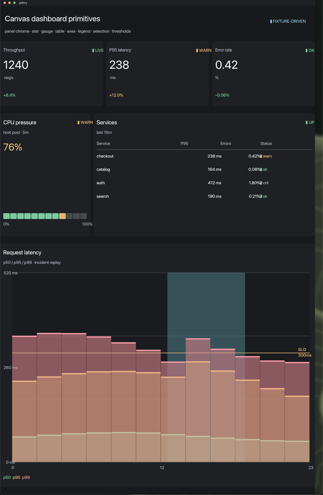

# Dashboard component gallery API



## Entrypoint

`view.lua` exports `M.render(snapshot)` and paints the reusable
`fungos.dashboard` primitives on a 1200x840 Canvas scene.

## Opening the surface

Copy the widget fixture once, then open it through Canvas:

```sh
cp examples/gallery/gallery.json "$HOME/.canvas/widgets/gallery.json"
printf 'open_widget %s gallery\n' "$HOME/.canvas/widgets/gallery.json" | canvasctl
```

## Snapshot

`snapshot.lua` is deterministic fixture data:

- `stats[]` — label, value, unit, delta, status;
- `gauge` — value, range, unit and threshold steps;
- `table` — columns and rows, including status cells;
- `chart` — series points, y range, threshold and selection.

The fixture deliberately uses the same shapes as the shared dashboard contract,
so a live Spore can swap in observed values without changing the gallery.

## Actions

None. Presentation only.

## Slots

None.

## Components

`fungos.dashboard` exports:

- `panel` — panel chrome and a content rectangle;
- `stat` — value, unit, delta and status;
- `gauge` — segmented threshold meter;
- `table` — headers, rows, zebra striping and status cells;
- `chart` — compact axes, grid, series columns, legend, threshold and selection;
- `status`, `status_ink`, `threshold_ink`, `format` — shared formatting helpers.

## Theme/config

Uses semantic Canvas inks only. Raw RGB is left to GPU scene hosts.

## Stable ids

Every primitive prefixes its call-site id. The gallery uses `gallery-stat-*`,
`gallery-gauge`, `gallery-table`, and `gallery-chart`.

## Authority

None. No records, network, clock, filesystem or actions.
